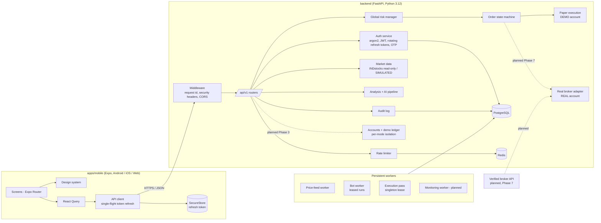

# QuantAI F&O architecture

Status: v2 plan, **Phase 1 done** (see [implementation-plan.md](implementation-plan.md)).
The original phases 1–6 (auth, UI, INDstocks data, analysis, bots, risk + paper execution)
are implemented. Boxes marked *planned* do not exist yet.



## Account modes

The app has one UI and two financial account modes:

- **DEMO** (`DEMO · VIRTUAL` badge): ₹10,000 virtual funds, simulated orders and fills.
- **REAL** (`REAL` badge): funds, orders and positions from a verified broker. Not available yet.

Synthetic market prices are a different concept and show a `SIMULATED` badge. The shared
strategy, AI and risk code produces a trade proposal; the server (never the client) decides
which execution adapter receives it from the account it belongs to. The isolation design
(accounts table, demo ledger, composite keys, adapter guards) is in
[implementation-plan.md](implementation-plan.md#account-isolation-design-phase-3-for-review).
Today only the DEMO path exists and the selector shows REAL as unavailable.

## Principles applied in Phase 1

- **Live trading is hard-locked.** `LIVE_TRADING_ENABLED=true` makes the settings
  loader raise at startup. `/api/v1/system/status` lists the open blockers.
- **Data provenance is explicit.** Every market payload carries `source`, `is_demo`,
  `is_live` and `as_of`. The UI always renders a `DataSourceBadge` and flags data older
  than 60 s as `STALE`.
- **Unbuilt modules say so.** The UI shows "Not built yet · Phase N" cards and never
  renders placeholder numbers.
- **Security defaults.** Argon2id password hashes. 15-minute access JWTs bound to a
  server-side session row, so logout and revocation take effect immediately. Rotating
  refresh tokens are stored as HMAC hashes; re-using a consumed token revokes the
  session. OTPs are hashed, expire after 10 minutes and burn after 5 failed attempts.
  Accounts lock after 5 failed logins. Auth routes are rate limited per IP. Logs are
  JSON with sensitive keys redacted, and every response carries a request ID.
- **Environment guards.** Staging, paper and production refuse to start with the dev
  secret, SQLite, console OTP delivery or `DEBUG=true`.
- **Time.** All timestamps are stored as UTC (`timestamptz`) and shown in IST in the app.
- **Money types.** `Money`, `Price` and `Quantity` (`NUMERIC(18,4)`) are defined in
  `app/db/base.py` for the trading tables added in later phases. Floats are not used.

## Repository layout

```text
apps/mobile/          Expo app (JS/JSX)
  app/                Expo Router routes: (auth) group, (app)/(tabs), stacks
  components/ui/      Design system components
  constants/theme.js  Design tokens (dark + light)
  features/           Feature API hooks and feature components
  hooks/ services/ store/
backend/
  app/api/v1/         Routers (health, system, auth, users, admin, market)
  app/core/           Config, security, errors, logging, rate limiting
  app/db/ app/models/ SQLAlchemy 2.x base and models
  app/schemas/        Pydantic contracts
  app/services/       Use cases (auth, audit, OTP delivery)
  app/market_data/    Demo provider (real providers in Phase 3)
  migrations/         Alembic
  tests/
docs/                 Architecture, API, OpenAPI spec
scripts/              E2E web smoke test
```
